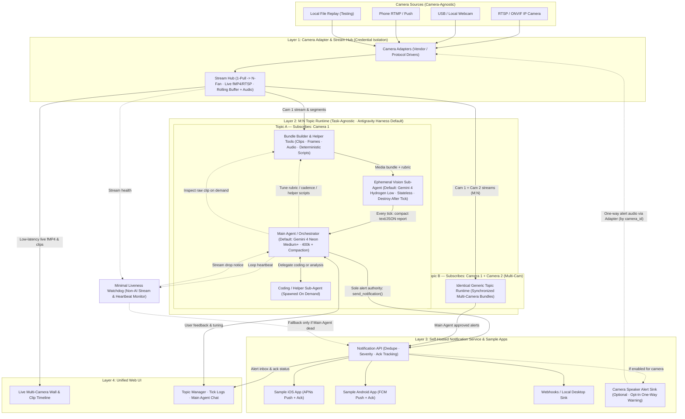

# Vision Sentinel — Architecture Blueprint

> **Status:** `v0.1` MVP, Milestones M1–M4 implemented (MIT License). This document records the design and the decisions behind it.
> **Primary Audience:** Maintainers, architecture reviewers, and coding agents contributing to or deploying the repository.

---

## 1. Overview & Core Thesis

This project is an open-source, **camera-agnostic**, **task-agnostic**, and **harness-agnostic** vision-based AI alerting system. It is designed to run local-first on user-owned hardware. **Harness-agnostic** has a specific meaning here: the system runs on an official coding-agent CLI paired with its own model family (Antigravity `agy` with Gemini, Claude Code with Claude, and similar), used in the way that vendor permits. It does not mean any raw model API, and it never means reverse-proxying or reusing a harness's OAuth sign-in. Antigravity with Gemini is the first-class, first-built driver.

> **Disclaimer — where your video goes.** This is an educational project. Orchestration, storage, and the Web UI run on your own hardware, but perception does not: with the default configuration, each observation sends video frames and audio from your cameras to the configured model provider. What the provider retains, and whether it may be used for training, depends on the provider and on the access tier you use. Choosing that is up to you (for example, an API tier with zero data retention); the project does not enforce or verify it.

### Why This Architecture

Continuous camera monitoring with AI usually fails in one of two ways:

1. **Rigid CV Pipelines:** Traditional detectors and hand-tuned rules break whenever the camera angle, lighting, scene, or monitoring goal changes, and require heavy engineering per use case.
2. **Naive Continuous VLM Sessions:** Feeding raw video frames continuously into a single long-lived multimodal agent rapidly causes cost explosion, context bloat, and visual hallucination drift.

### Core Thesis: Split Perception from Control

We separate **stateless multimodal perception** from **stateful orchestration, tool-building, and alert authority**:

- **Ephemeral Vision Sub-Agent** *(default: Gemini 4 Hydrogen, Low)*: Spawned fresh for each observation window with **zero carried memory**. It inspects a bounded media bundle (short clip / contact sheet / audio / optional deterministic telemetry) against a clear rubric, returns a compact structured report (a few hundred tokens of text/JSON), and is immediately discarded.
- **Stateful Main Agent / Orchestrator** *(default: Gemini 4 Neon, Medium+ reasoning)*: Long-lived per monitoring **Topic** (operating within a ~400k token context window managed by Antigravity compaction or a pluggable compaction strategy). It does **not** ingest raw continuous video streams. Instead, it:
  1. Reviews **every** report returned by its Vision Sub-Agent.
  2. Acts as the **sole controller and gatekeeper for every notification**.
  3. Inspects raw clips on demand only when an observation is suspicious, ambiguous, or under user review.
  4. Iteratively tunes the Vision Sub-Agent (prompt, rubric, cadence, crops) and **writes deterministic helper code** (or spawns coding sub-agents) to improve accuracy and lower cost.

---

## 2. Explicit Scope & Boundaries

Clear boundaries are critical before writing code. This section defines what the open-source system **will** build and what it **explicitly will not** build.

### 2.1 In Scope (What We Will Build)

| Area | What We Deliver |
|---|---|
| **Camera Adapter & Stream Hub** | Vendor-agnostic ingestion adapters (RTSP, ONVIF, local webcam/USB, RTMP/phone ingest, local video file replay) normalized into a single internal stream format + rolling segmented media buffer (video + audio + stream health), plus an optional opt-in one-way speaker output capability where hardware supports it. Strict single-pull fan-out so downstream consumers never connect directly to cameras or see credentials. |
| **Many-to-Many (M:N) Topic Engine** | A generic `Topic` abstraction supporting **1 camera → N topics** (multiple tasks on the same feed with zero extra camera sessions) and **M cameras → 1 topic** (multi-camera correlated observation for one decision). |
| **Two-Tier Agent Runtime** | Orchestrator + Ephemeral Vision Sub-Agent execution loop built on the **Antigravity harness** (reusing native sub-agent delegation and ~400k compaction). Models are configurable per Topic. All agent calls go through one `AgentHarness` interface, so another official coding-agent CLI (for example Claude Code with Claude) can be driven the same way (§5.3). |
| **Main-Agent Control Plane** | Full control authority in the Main Agent: reviewing every Vision Sub-Agent return, deciding every alert, inspecting clips on demand, tuning sub-agent instructions/cadence, and writing/running scoped helper scripts (or delegating to coding sub-agents). |
| **Notification Service + Sample Mobile Apps** | A self-hosted Notification Service API with pluggable sinks (mobile push, webhook, local desktop, and optional **camera speaker alert** for one-way warnings on supported cameras) plus **two open-source sample mobile apps (iOS + Android)** supporting push notifications (APNs / FCM) and alert acknowledgment. |
| **Unified Web UI** | A single web interface combining live multi-camera viewing, rolling clip/alert playback, Topic management, inspection of Vision Sub-Agent logs, and direct chat with each Topic's Main Agent. |
| **Agent-First Setup Documentation** | Machine-readable, step-by-step setup runbooks and verification scripts written specifically so a user's coding agent can read the repo and configure the stack automatically, pausing cleanly only for unavoidable human account steps (e.g., GCP/Firebase, Apple Developer). |
| **Minimal Liveness Watchdog** | A tiny, non-AI health monitor that detects dead camera feeds or a crashed runtime and triggers a fallback "system offline" alert if the Main Agent itself cannot run. |

### 2.2 Out of Scope (What We Explicitly Will NOT Build)

1. **Not a Conversational Voice Assistant or Two-Way Intercom System:**
   - No wake-word detection, no interactive voice conversation, and no live two-way intercom chat. *(Note: **one-way** camera-speaker playback is supported strictly as an optional, opt-in Notification Sink for alert/warning/deterrence use cases when the Camera Adapter supports speaker output.)*
2. **Not a Medical Device or Certified Life-Safety Alarm:**
   - The system is a best-effort AI alerting layer. It must never be marketed or architected as a replacement for human supervision or certified medical/security equipment.
3. **Not a Hosted SaaS or Multi-Tenant Cloud Platform:**
   - Local-first and self-hosted by design. Maintainers do not operate a hosted cloud backend, user accounts, billing, or shared push-notification relay service.
4. **Not a Full NVR / Long-Term Surveillance Archive:**
   - Maintains a configurable short rolling buffer (for recent context and clip extraction) plus saved incident/review clips—not months-long VMS archiving, RAID storage management, or enterprise NVR administration.
5. **Not a Vertical / Domain-Specific Product in Core:**
   - Core packages contain zero hardcoded domain logic (no baked-in nursery, pet, wildlife, or security rules). Concrete use cases ship strictly as **example Topic templates** outside the core engine.
6. **Not a Custom Agent Framework Re-Inventing the Harness:**
   - We build on Antigravity's existing harness primitives (sub-agents, tool execution, session compaction) rather than building a bespoke general-purpose agent OS from scratch.
7. **Not Zero-Click Provisioning for External Walled Gardens:**
   - We cannot automate Apple Developer account enrollment, Xcode signing identity approval, or GCP/Firebase billing/org creation. We automate everything locally and provide exact human checklists for those external gates.
8. **Not a Model Training / Fine-Tuning Suite:**
   - No dataset labeling pipeline or VLM/CV training infrastructure in v1. Adaptation happens through agent-authored prompts, deterministic helper scripts, and reference clip curation.

---

## 3. Glossary

| Term | Definition |
|---|---|
| **Camera / Source** | Any physical or virtual video/audio producer (IP camera, webcam, phone stream, prerecorded video file). |
| **Camera Adapter** | A pluggable ingestion driver that connects to a specific camera/protocol and publishes it into the Stream Hub. The only component allowed to handle camera credentials. |
| **Universal Stream** | The normalized internal representation of a camera feed (standard RTSP/fMP4 live stream + rolling disk segments + audio track + health metadata), addressed purely by logical `camera_id`. |
| **Topic** | A user-defined monitoring objective (e.g., *"watch front porch for delivered packages"* or *"alert if the garage door stays open after dark"*). Owns its camera subscriptions, Main Agent session, helper scripts, Vision Sub-Agent config, and alert history. |
| **Observation Bundle** | The time-bounded package produced for a single Vision Sub-Agent pass: short video clip(s), contact sheet(s), extracted audio, timestamps, and outputs of any Topic-specific helper scripts across one or more subscribed cameras. |
| **Main Agent (Orchestrator)** | The stateful, long-lived agent bound to a Topic (default: Gemini 4 Neon, Medium+ reasoning). Reviews every Vision Sub-Agent report, controls all notifications, inspects clips on demand, writes helper tools, and tunes the Vision Sub-Agent. |
| **Vision Sub-Agent** | The stateless, ephemeral multimodal worker (default: Gemini 4 Hydrogen, Low) invoked once per observation tick. Reads one Observation Bundle, emits a structured report, and terminates with no retained memory. |
| **Coding / Helper Sub-Agent** | A standard harness sub-agent spawned on demand by the Main Agent to implement or debug helper scripts, run offline clip evaluations, or refactor Topic tooling without crowding the Main Agent's context. |
| **Helper Tool / Preprocessor** | Deterministic, zero-LLM-token code (e.g., ROI crop, motion/pixel-diff score, audio RMS/dBFS, signal extractor) written or configured by the Main Agent and executed during bundle assembly. |
| **Notification Service** | The local/self-hosted dispatch API that routes Main-Agent-approved alerts to mobile push (APNs/FCM), webhooks, local sinks, or optional opt-in camera speaker warnings, and tracks acknowledgments. |
| **Watchdog** | A minimal, independent health process that verifies stream liveness and agent loop heartbeats; emits a system-health alert only when the runtime or feed is blind/down. |

---

## 4. High-Level System Architecture



### End-to-End Lifecycle of One Monitoring Cycle

1. **Ingest & Buffer:** Camera Adapters pull streams once into the Stream Hub (e.g., MediaMTX-backed), continuously writing rolling fMP4 segments with audio.
2. **Bundle Assembly:** On a Topic's configured cadence (e.g., every 60–120 s, or event-triggered by a lightweight helper script), the Topic runtime slices the latest window from its subscribed camera(s), runs any Main-Agent-authored deterministic helper scripts, and writes an immutable `Observation Bundle` directory.
3. **Ephemeral Perception:** A brand-new **Vision Sub-Agent** is spawned with the Topic's current vision rubric and the Observation Bundle. It outputs a compact structured report (observations, confidence, anomalies, suggested clip review flag) and terminates immediately.
4. **Orchestrator Review & Control:** The compact report is delivered to the Topic's **Main Agent**.
   - **Normal tick:** Main Agent records/acknowledges silently in a tiny text turn. Zero media tokens enter its context.
   - **Ambiguous / High-risk tick:** Main Agent calls a tool to inspect the specific clip/frames/audio directly, compares against prior ticks in its session memory, and decides whether to:
     - suppress (and optionally refine the Vision Sub-Agent's rubric so the false alarm doesn't recur),
     - tighten the observation cadence temporarily, or
     - **emit a notification** through the Notification Service.
5. **User Interaction & Tuning (Unified UI):** From the same Web UI where they view live cameras and alert clips, the user chats directly with the Main Agent (e.g., *"ignore the tree shadow on the left"* or *"only alert if the gate stays open > 5 minutes"*). The Main Agent updates the rubric, writes/adjusts a helper script (or spawns a coding sub-agent to do so), tests it against recent clips, and applies the update live.

---

## 5. Component Boundaries & Contracts

### 5.1 Camera Adapter & Stream Hub (The Isolation Boundary)

- **Invariant ("The One Rule"):** Only the Camera Adapter / Stream Hub layer knows camera IP addresses, vendor protocols, RTSP URLs, or credentials. Topics, Agents, Helper Scripts, Notification Sinks, and the Web UI interact exclusively with logical `camera_id`s, local restream endpoints, extracted clips, and adapter capability APIs.
- **Adapter Contract:** Every adapter implements a minimal lifecycle (`probe`, `start`, `health`, `stop`) and publishes standardized video (H.264/H.265) + audio tracks into the Stream Hub. Adapters for cameras with speaker hardware may optionally implement a one-way `play_alert(audio, volume)` capability—**disabled by default per camera**, requiring explicit per-camera + per-topic opt-in and enforcing a hard configurable `volume_cap` (so quiet rooms can never be sounded accidentally).
- **v1 Built-In Adapters:**
  1. Generic RTSP / RTSPS
  2. ONVIF (auto-discovery + RTSP profile resolution)
  3. Local USB / built-in webcam (via FFmpeg)
  4. RTMP / RTSP push ingest (for phones or mobile cameras)
  5. File / folder loop replay (critical for offline testing, demos, and agent-automated verification without hardware)
  6. HTTP segment push ingest (a companion camera client, such as `clients/macos-camera`, POSTs short fMP4 segments; a Bearer token is required unless the receiver is bound to loopback)

### 5.2 Topic Model & M:N Topology

Each Topic is a self-contained directory (Git-friendly, human- and agent-readable):

```text
topics/<topic-id>/
  topic.toml              # subscribed camera_ids, cadence, window_sec, model overrides, alert defaults
  goal.md                 # the user's monitoring goal in their own words; read-only to every agent
  vision_rubric.md        # instructions & JSON schema maintained by Main Agent for Vision Sub-Agent
  orchestrator_notes.md   # pinned durable rules, calibration facts, user preferences (survives compaction)
  tools/                  # Main-Agent-authored deterministic preprocessors (e.g. crop.py, motion.py)
  state/                  # tick history JSONL, saved review/incident clips, alert audit log, human feedback log
```

- **The Topic directory is the state; the Main Agent session is disposable.** Ending a session and starting a fresh one from the Topic directory must produce the same monitoring behavior. Nothing the Topic depends on may live only in session history.
- **`goal.md` is the user's, not the agent's.** Only the user changes it (through the Web UI or by editing the file). The Main Agent may propose a rewording in chat but has no tool that writes it. It is loaded at the top of every Main Agent session and is never part of compactable history.

- **1 Camera → N Topics:** Multiple Topics reference the same `camera_id`. All read from the same Stream Hub rolling segments with zero extra load on the camera.
- **M Cameras → 1 Topic:** `topic.toml` lists multiple `camera_id`s. The Bundle Builder slices synchronized wall-clock windows from all listed cameras and tags each asset with its `camera_id` before passing the bundle to the Vision Sub-Agent.

### 5.3 Two-Tier Agent Runtime (Harness-Agnostic, Antigravity-First)

#### Model Defaults & Policy
- **Main Agent (Orchestrator):** Defaults to **Gemini 4 Neon** with **Medium or higher reasoning effort** (configurable per Topic).
- **Vision Sub-Agent:** Defaults to **Gemini 4 Hydrogen (Low)** (configurable per Topic).
- **What counts as a harness:** an official coding-agent CLI that already provides a persistent session, context compaction, sub-agent spawning, tool execution, and a non-interactive mode, paired with its vendor's models: Antigravity (`agy`) with Gemini, Claude Code with Claude, and others of the same kind. The project relies on the harness for those capabilities and does not rebuild them, so a bare model API is not a harness in this sense.
- **Build order:** the MVP ships the Antigravity driver only. The Claude Code driver follows once the Antigravity one works end to end (§9.3), and is the first real test of this interface.
- **Permitted use only:** each driver launches the vendor's official binary and lets it be the only client of the user's sign-in. No driver reads, copies, replays, or proxies a harness's OAuth credentials, and each driver's docs state the vendor terms it was checked against and when.
- **Harnesses differ in what media they can read.** A driver declares which bundle assets its Vision Sub-Agent can ingest (still frames, video, audio). The Bundle Builder gives the worker only those, and the report records which assets were actually read, so a Topic that depends on audio is visibly degraded on a harness that cannot hear rather than silently blind to sound.
- **Agnostic Abstraction:** All model/runtime invocations pass through a thin `AgentHarness` adapter:
  - `run_vision_worker(bundle, rubric, model_config) -> VisionReport` *(must be stateless/ephemeral)*
  - `deliver_to_orchestrator(topic, event) -> OrchestratorResult` *(stateful session)*
  - `chat_with_orchestrator(topic, message, attachments) -> OrchestratorResult`
  - `media_capabilities() -> MediaCapabilities` *(which bundle assets the worker can ingest)*
  - Coding / helper sub-agents are spawned by the harness's own native mechanism, not through this interface.
- **Antigravity First-Class Driver:** Uses Antigravity's native CLI/runtime (`agy`), native sub-agent spawning, and built-in session compaction (~400k context window).
- **How the Antigravity driver uses the user's sign-in:** every model request goes through the official `agy` binary, which remains the only OAuth client. This project is a layer that launches `agy`. That is the line the Antigravity terms draw (their example of a breach is a third-party client using Antigravity OAuth directly), and forum replies from Sept 2026 describe headless `agy -p` under one's own account as supported and compliant. Two caveats for users, checked 2026-11-25: the terms contain no clause about unattended or always-on use either way, and personal-plan quotas are unpublished and refresh on five-hour and weekly windows, so an always-on Topic can run out (§8.1). A Gemini API key is the alternative for users who want published limits or a chosen data-retention tier.
- **Context & Compaction Strategy:**
  - Nominal ticks append only compact structured text to the Main Agent session; raw media is excluded unless explicitly requested by the Main Agent.
  - Antigravity's built-in compaction handles long-running session history within the ~400k window.
  - To prevent subtle preference loss across compactions, durable user rules and calibration findings are mirrored to `orchestrator_notes.md` (pinned/reloaded on session start or compaction).
  - The user's goal (`goal.md`) is pinned separately from the notes and rubric the agent edits, and is read-only to the agent (§5.2).
  - **The runtime keeps the counters.** Running state that a decision depends on (how many consecutive ticks a condition has held, how long since it started, time since the last notification per dedupe key) is computed by the runtime from the tick log in `state/` and attached to every report delivered to the Main Agent. The Main Agent decides with those figures in front of it; it is never required to recall them from session history.

#### Main Agent Review Policy
- **Default: every tick.** Each Vision Sub-Agent report is delivered to the Main Agent as its own turn. This is the simplest form of the core thesis and stays the default unless the measurement in §8.1 shows it does not fit within quota, cost, or latency limits.
- **Optional: agent-set quiet policy (per Topic).** The Main Agent may define what counts as an all-clear report for its Topic and a digest interval. The runtime then batches consecutive all-clear reports into one digest turn per interval and delivers any other report immediately. The policy is the Main Agent's own choice: it sets, changes, or revokes it with `update_review_policy`, and the runtime never hides a report on its own initiative. Every batched report still reaches the Main Agent in the digest.
- **Optional: deterministic tool triggers (`tools/`, zero-token fast path).** A Main-Agent-authored helper script in `topics/<id>/tools/` runs on every bundle before the Vision Sub-Agent. If a tool's JSON stdout includes `"skip_vision": true`, the runtime bypasses the Vision Sub-Agent completely (0 Vision tokens):
  - **Quiet tick (`"trigger": false`):** logs the deterministic tick and records a zero-token `tool_bypass` review (keeping Watchdog liveness healthy without growing the unreviewed backlog) — **0 Vision tokens and 0 Main Agent tokens**.
  - **Triggered tick (`"trigger": true`, or any degraded bundle):** skips the Vision Sub-Agent and **wakes the Main Agent immediately** with the tool's summary, observations, conditions, and raw metrics so the Main Agent can judge, optionally call `inspect_media`, and decide whether to `send_notification`.
  - **Hybrid gate:** return `{"skip_vision": true, "trigger": false}` while quiet and `{"skip_vision": false, "trigger": true}` when a signal fires so the Vision Sub-Agent inspects only triggered windows.
  - Because trigger tools cannot send notifications directly, the Main Agent remains the sole business-logic alert authority.
- **Measured harness overhead (2026-11-25, `agy` 1.5.16–1.5.17):**
  - Fresh session per call (`agy` 1.5.16): a Main Agent call on Neon Medium carries about 18,200 input tokens before any report content (n=5, none cached); a Vision Sub-Agent call on Hydrogen Low with one small image carries about 23,000. A design that starts a fresh Main Agent session per tick would therefore spend about 26M input tokens a day at a 60 s cadence on overhead alone.
  - Continued session (`agy` 1.5.17, `--resume <conversation_id>`, n=2 on `gemini-4-neon-medium`, 2026-11-25): prompt cache hits heavily—Turn 1 reported `2,961` uncached input + `15,107` `cache_read_tokens` (`3.2 s`), Turn 2 reported `5,075` cumulative uncached input + `32,224` cumulative `cache_read_tokens` (`8.7 s`). `agy` 1.5.17 also supports persistent `--input-format stream-json --output-format stream-json` for multi-turn stdio sessions without per-tick process launch overhead.
- **Measured audio ingestion control (2026-11-25, `agy` 1.5.17, `gemini-4-hydrogen-low`, `--mode plan`, `cwd` = bundle directory):** given a blind 16 kHz mono MP3 (`control.mp3`) speaking `"Code word falcon seven four two nine"` with no other context, the worker transcribed `"Code word falcon 7 4 2 9."` in `6.45 s` (`21,209` input, `16,736` cache read, `287` output). Audio ingestion is therefore verified for the Antigravity driver when invoked inside the bundle directory.
- **Measured Vision Sub-Agent cost over one overnight run (2026-11, about nine hours on Hydrogen Low at a 2-minute cadence, read back from `agy` session records):** 278 checks, each a fresh session reading a contact sheet, an audio file, and a close-up frame. Per check: duration p50 9 s [6–22], p95 13 s; uncached input p50 25,900 tokens [23,200–43,100] plus 18,900 cache-read; output p50 714; thinking p50 415. Whole night: 7.1M uncached input, 5.2M cache-read, 0.32M output and thinking. All 278 completed within quota on a personal sign-in; the interval between check starts was p50 120 s [22–225], with six intervals over 150 s. This covers the worker only, with no Main Agent reviewing.
- **Why the option exists:** each Main Agent turn processes its whole session, not just the new report. At a 60 s cadence and roughly 350 tokens per tick, a Topic adds about 500k tokens of history per day, so 1,440 turns over an average ~200k context is on the order of 290M input tokens per day (about 90M at 120 s). These are estimates from this document's own figures, not measurements. On OAuth-based harness access the constraint is quota and rate limits (an exhausted quota stops the sole alert authority); on a paid API key it is spend, reduced by prompt caching only while the cache stays warm; in both cases a larger context means a slower turn.

#### Main Agent Tool Surface
The Main Agent operates with an explicit, auditable tool set:
- `inspect_media(bundle_id, camera_id, asset)` — inspect a clip, close-up frame, or audio snippet on demand.
- `send_notification(severity, title, body, clip_ref, dedupe_key, requires_ack, breaks_mute)` — **the sole business-logic path to alert the user**. `breaks_mute` lifts a user-set "until next event" mute when a new, distinct event occurs.
- `clear_mute(reason)` — lift an "until next event" mute without alerting, once the muted episode has clearly ended.
- `update_vision_rubric(content)` / `update_schedule(cadence_sec, window_sec)` — tune the ephemeral Vision Sub-Agent.
- `update_review_policy(all_clear_definition, digest_interval_sec | none)` — set or revoke the Topic's quiet policy (`none` restores every-tick review).
- `edit_topic_tool(path, code)` & `test_topic_tool(bundle_id)` — write and validate deterministic preprocessors inside `topics/<topic-id>/tools/` (by convention, a Topic's tools live in its own directory).
- Beyond these named tools, the Main Agent keeps the harness's full native tool set (shell, file access, network) with full permissions (§5.7). The named tools are the audited paths for Topic operations, not a limit on what the agent may do.
- `spawn_subagent(task)` — a note for the audit log only: complex coding, clip batch-analysis, or debugging is delegated to a standard Antigravity coding sub-agent, which the harness spawns itself.

### 5.4 Notification Service & Reference Sample Apps

- **Notification Service (Self-Hosted):**
  - Clean HTTP API (`POST /v1/alerts`, `POST /v1/alerts/{id}/ack`, `POST /v1/alerts/{id}/feedback`, `POST /v1/devices/register`, `GET /v1/alerts`).
  - Supports severity tiers (`info`, `warning`, `urgent`), deduplication/cooldown keys, clip thumbnail/link references, and acknowledgment status.
  - **Human feedback is part of the MVP alert path.** Every alert can be rated thumbs up (right to alert) or thumbs down (false alarm), with an optional short note, from the push notification, the sample apps, or the Web UI Alert Inbox. Feedback is separate from acknowledgment: ack means "seen", feedback means "was this correct", and it may arrive later or not at all.
  - **Feedback is logged from day one.** Each rating is appended to the Topic's `state/` as one record: alert id, rating, note, who and when, the Observation Bundle id, and the rubric and helper-tool versions that produced the alert. The rated bundle is kept as a saved clip, exempt from rolling-buffer expiry. The MVP only records this and passes the rating to the Main Agent as a feedback event; using the log for checked tuning is §9.1.
  - Built-in delivery sinks:
    - **APNs** (direct outbound HTTP/2 using user's Apple `.p8` key)
    - **FCM** (direct outbound HTTPS using user's Firebase/GCP service account)
    - **Generic Webhook** (Slack, Discord, Pushover, Home Assistant, ntfy, custom HTTP)
    - **Local Desktop Notification / Sound** (useful for quick local testing with zero mobile setup)
    - **Camera Speaker Alert Sink (Optional, Opt-In)** — routes a one-way warning chime, siren, or spoken alert (pre-recorded clip or TTS) back to a camera's speaker via the Camera Adapter by `camera_id` (e.g., perimeter deterrence, warning someone off a restricted area, or shooing a pet off furniture). Disabled by default; strictly requires per-camera + per-topic opt-in and respects the adapter's hard volume cap.
- **Sample Mobile Apps (Open-Source Reference Clients):**
  - `mobile/ios/` — Minimal Swift/SwiftUI app registering for APNs push notifications, displaying alert details + attached clip/snapshot (when reachable via LAN/VPN/tunnel), and sending Acknowledge and thumbs up/down feedback callbacks.
  - `mobile/android/` — Minimal Kotlin/Jetpack Compose app registering for FCM push notifications, supporting high-priority/alarm notification channels (with optional DND bypass guidance) and inline Acknowledge and thumbs up/down feedback (phone + companion watch).
  - Both sample apps are strictly generic templates with configurable server URL and token—zero hardcoded personal endpoints or credentials.

### 5.5 Unified Web UI

A single local web application serving both **observation** and **agent interaction**:

- **Live Wall:** Live view for all configured cameras with stream health indicators: native-frame-rate H.264 (fragmented MP4 played through Media Source Extensions, remuxed by the Stream Hub without transcoding), falling back to MJPEG and then snapshots.
- **Timeline & Clip Inspector:** Scrub rolling buffer segments and jump directly to alert clips or Vision Sub-Agent observation timestamps.
- **Topic & Agent Workspace:** Create/pause/edit Topics, assign M:N cameras, inspect live Vision Sub-Agent tick logs (structured JSON + token metrics), and **chat directly with the Topic's Main Agent** side-by-side with the live feed and clips.
- **Alert Inbox:** View sent notifications, acknowledgment status, and give one-click feedback (*"True positive"* / *"False alarm — teach agent"*) that feeds directly into the Main Agent chat.

### 5.6 Minimal Liveness Watchdog

- Independent lightweight process watching two things only:
  1. Stream Hub ingestion health (camera unreachable / stalled segments).
  2. Main Agent review progress per Topic: the age of the newest tick the Main Agent finished reviewing. A process heartbeat is not enough, since a session can be alive while its turns time out or are refused for quota.
- When a camera drops while the Main Agent is healthy, the Watchdog notifies the Main Agent so it can decide whether to alert.
- Only when review progress for a Topic is stale past a timeout (Main Agent dead, hung, rate-limited, or out of quota) does the Watchdog emit a direct system-health alert via the Notification Service. This is the only notification that does not come from the Main Agent.
- **Resume and replay:** the runtime restarts the Main Agent session from the Topic directory. Reports produced while the Main Agent was unavailable are queued, not dropped, and are delivered in order on resume, marked as late, so an event during the outage is still reviewed and can still be notified.

### 5.7 Access & Auth (MVP)

**Security bar for the MVP: not hackable, but not production-deployable.** The obvious ways in are closed (an open device API, camera content steering the agents, a worker with shell access). Nothing beyond that is promised: no hardening for hostile networks, multi-user access, or hosted operation. This is a household project.

The MVP adds authentication only where a call crosses from a device to the server, and nowhere else.

- **Device → server calls require a token.** Device registration, acknowledgment, feedback, and alert/clip fetches from the mobile apps (`/v1/devices/register`, `/v1/alerts/{id}/ack`, `/v1/alerts/{id}/feedback`, `GET /v1/alerts`, clip and snapshot URLs) must carry a shared household token, generated at setup, stored in the server's secret storage, and entered once in each app. Calls without it are rejected. This is the minimum needed so that not everyone who can reach the server can register a phone or acknowledge an alert.
- **Server-internal calls stay local.** The Topic runtime and Watchdog post alerts (`POST /v1/alerts`) over the loopback interface; that endpoint is not offered to devices.
- **The Web UI has no login in the MVP.** It is assumed to be reachable only from the household's own network or the user's own private tunnel (§8.5). Anyone who can reach it can view the cameras and chat with the Main Agent, so the setup docs must say plainly: do not expose the Web UI port to the public internet.
- **Camera content is observation, never instruction.** Text visible in frame and speech in the audio can reach the Vision Sub-Agent, and through its report the Main Agent. Two rules close this:
  - The Vision Sub-Agent runs with no tools beyond reading its own Observation Bundle: no shell, no network, no file writes, and no reads outside the bundle directory. The harness driver must enforce this through the harness's permission settings, not through a sentence in the prompt. On Antigravity this is `agy --mode plan` launched with `cwd` set to the Observation Bundle directory (and **without** `--dangerously-skip-permissions` or `--add-dir`), tested 2026-11-25 on `agy` 1.5.16–1.5.17: the worker read images and `.mp3` audio inside its `cwd` and returned schema-constrained output (`--json-schema`), auto-denied `read_file` on paths outside its `cwd`, and created no files when told to run a shell command and write a file. The default headless mode and `--sandbox` do not restrict: in the same test both ran the shell command and wrote the file, with or without `--dangerously-skip-permissions`.
  - The Main Agent's fixed instructions state that Vision Sub-Agent reports and anything seen or heard on camera are data to be judged. Only the user's chat and `goal.md` instruct it.
- **The Main Agent and its Coding / Helper Sub-Agents run with full harness permissions.** This is deliberate: much of the system's value comes from the Main Agent solving problems in ways nobody planned for, and tight restrictions remove that. The restricted party is the Vision Sub-Agent, which is the only agent that reads raw camera content directly. The consequence is stated rather than hidden: the Main Agent can do anything the user account running it can do on that machine, so the instruction rule above is the only thing standing between camera content and those permissions.
- **Loopback services check who they are addressed as.** On a loopback bind the Web UI rejects requests whose `Host` header is not a loopback name (or one named with `--allow-host`), and `POST /v1/alerts` requires a loopback `Host` as well as a loopback peer. Without this, a web page open in the user's own browser could reach either port by DNS rebinding.
- **Push ingest needs a token off loopback.** The HTTP segment push receiver (§5.1) refuses to start on a non-loopback bind without a Bearer token (`credential_ref`), so nobody on the network can feed a camera fake video.
- **Not in the MVP:** user accounts, per-user roles, per-device revocable tokens, token rotation, audit of who did what. See §9.2.

---

## 6. Agent-First Onboarding & Setup Philosophy

This repository is designed under the assumption that **most users will deploy it using a coding agent** (Antigravity, Claude Code, Codex, etc.) rather than manually following 20 pages of prose.

### Principles
1. **Executable Runbooks (`SETUP_FOR_AGENTS.md`):** Setup instructions are written as deterministic agent workflows with exact commands, expected outputs, pass/fail checks, and rollback steps.
2. **Zero-Hardware Fast Start:** A user's agent can verify the entire pipeline locally in minutes using the **File Replay camera adapter** + **Local Desktop / Webhook sink** before touching real cameras or mobile push credentials.
3. **Explicit Human-Gate Handoffs:** External services that require personal accounts or browser console clicks are isolated into clear, minimal **Human Checklists** where the user's agent pauses, asks the user to perform only the unavoidable manual step, and resumes automated verification afterward:
   - **Android Push (FCM):** User creates a Firebase/GCP project, registers the sample Android app package ID, downloads `google-services.json` and the FCM service-account JSON.
   - **iOS Push (APNs):** User enrolls/signs in to Apple Developer, creates an App ID with Push Notifications enabled, generates an APNs Auth Key (`.p8`), and selects their signing team in Xcode.
   - **OS / Network Permissions:** User approves macOS Local Network privacy prompts (if applicable) and supplies local camera credentials into local keychain/secret storage.
4. **Secret Hygiene by Default:** No `.env` templates encouraging committed secrets; setup docs default to OS keychain / secret-injection wrappers and redact credentials in all `--check` and log outputs.

---

## 7. Repository Layout

```text
<repo-root>/
  README.md
  SETUP_FOR_AGENTS.md           # Agent-executable end-to-end onboarding runbook
  SECURITY.md                   # Security boundary and how to report a vulnerability
  CONTRIBUTING.md               # Development setup, tests, and contribution rules
  docs/
    ARCHITECTURE.md             # This document
    CAMERA_ADAPTERS.md          # Adapter interface & adding new camera types
    HARNESS_ADAPTERS.md         # Antigravity default + adding another official agent CLI; vendor terms checked per driver
    NOTIFICATIONS_SETUP.md      # Local service + APNs/FCM human-gate checklists
  packages/
    streamhub/                  # Camera adapters, MediaMTX/FFmpeg hub, rolling segments, health
    runtime/                    # Topic engine, M:N bundle builder, harness interface, watchdog, CLI
    harnesses/
      antigravity/              # First-class Antigravity (agy) + Gemini driver
    notify/                     # Self-hosted Notification Service + APNs/FCM/Webhook/Desktop/CameraSpeaker sinks
    ui/                         # Unified Web UI (live view + clips + Main Agent chat)
  clients/
    macos-camera/               # Native macOS camera client that pushes segments to the HTTP ingest adapter
  mobile/
    ios/                        # Open-source SwiftUI sample app (APNs push + ack)
    android/                    # Open-source Kotlin/Compose sample app (FCM push + ack)
  examples/
    topics/                     # Sample Topic templates (package watch, door left open, desk watch, replay demos)
    sample-media/               # Tiny synthetic test clip for zero-hardware smoke tests
  assets/                       # App icon source
```

---

## 8. Design Decisions & Open Questions

The architectural tradeoffs weighed during design: what was decided, what was measured, and what is still open. Feedback on the open ones is welcome through the issue tracker.

1. **Main Agent Review Frequency vs. Cost / Latency:**
   - **Decision (2026-11-25):** every tick is reviewed by default; an agent-set quiet policy is available per Topic (§5.3, "Main Agent Review Policy"). The Main Agent remains the sole authority over notifications in both modes.
   - **Measured so far (2026-11-25):** single turns only, on a fresh session (§5.3 overhead figures, §8.2 turn time). No overnight run has been logged yet, so quota under continuous use, compaction frequency, and turn time on a long session are all unmeasured.
   - **Pending measurement:** the default is provisional until one overnight run with the Main Agent reviewing every tick at a 60 s cadence on one Topic. Record tokens per turn (input, cached, output), turn latency p50 [min–max] with n, number of compactions, and whether harness quota or rate limits were reached.
   - **Exit rule:** if the night stays comfortably inside quota and turn latency is acceptable for urgent alerts, every-tick review stays the default. Otherwise the quiet policy becomes the default and every-tick review the per-Topic option.
2. **Urgent Alert Latency (Two-Hop Turn):**
   - Vision Sub-Agent (Hydrogen Low) → Main Agent review (Neon Medium+) → Notification adds one orchestrator reasoning turn (measured 2026-11-25 on Neon Medium, text-only review of one report on a fresh session: wall time p50 10.2 s [9.9–11.7], n=5, of which about 2.7 s is `agy` process start; a long session is expected to be slower and is unmeasured) before the phone rings.
   - *Open question:* Is that latency acceptable across target use cases, or should Topics support a configurable reasoning-effort tier for urgent review?
3. **Compaction Durability:**
   - Relying on Antigravity's built-in ~400k compaction is clean, but long-running Topics accumulate user corrections over weeks.
   - **Decision (2026-11-25):** the session is treated as disposable (§5.2). The user's goal is pinned read-only in `goal.md`, running counters come from the runtime on every report (§5.3), and agent-maintained notes and rubric are reloaded from the Topic directory.
   - *Open question:* corrections given in chat survive only if the Main Agent writes them to `orchestrator_notes.md`, at the right scope. How do we verify that (for example, a restart test: end the session, start fresh, and replay saved bundles to confirm the same decisions)?
4. **Sandboxing Main-Agent-Authored Helper Code:**
   - Letting the Main Agent write and run deterministic helper scripts (Python/FFmpeg/OpenCV) is a superpower, but buggy or runaway code could stall a Topic or leak files.
   - **Decision (2026-11-25):** no sandbox for the Main Agent or its coding sub-agents in the MVP; they run with full harness permissions (§5.7). Only the Vision Sub-Agent is restricted.
   - **Decision:** helper scripts run inside the tick path, so each run gets a hard timeout (`tool_timeout_sec`, 30 s by default). A runaway script marks the bundle degraded and the tick goes on. That is a reliability guard, not a permission limit.
   - **Known limit:** with full permissions, the Main Agent could read camera credentials that are readable by the same user account. In the MVP, The One Rule (§5.1) governs what the system hands to agents, helper tools, and the Web UI; it is not OS-level isolation from the Main Agent. Keeping credentials where the agent's account cannot read them is future work.
5. **Remote Reachability for Mobile Sample Apps (Ack + Clip Preview):**
   - Outbound APNs/FCM push works from any home machine behind NAT with zero inbound ports. However, **Acknowledge callbacks** and **clip previews** from outside the LAN require connectivity back to the self-hosted server.
   - **Decision:** push delivery stays 100% direct outbound, and `NOTIFICATIONS_SETUP.md` documents the standard self-hosted remote options (Tailscale, Cloudflare Tunnel, reverse proxy) for acknowledgment and clip preview.
6. **Multi-Camera Synchronization Semantics:**
   - For an M-camera Topic, cameras may have slight clock skew or momentary drops on one feed.
   - **Decision:** the Bundle Builder slices every subscribed camera over the same Stream Hub wall-clock window and records an explicit per-camera status (`ok`, `degraded`, or `offline`) in the bundle for the Vision Sub-Agent.

---

## 9. Future Improvements (Post-MVP)

Deliberately left out of the MVP. Listed here so the MVP's limits are stated and the later design has a starting point.

### 9.1 Evidence for Main Agent Tuning

**MVP behavior:** the Main Agent changes the vision rubric, cadence, and helper tools on its own judgment. A "test against recent clips" confirms that a change runs, not that detection improved or held, because recent clips carry no labels. A change made to stop a false alarm can therefore reduce sensitivity without anyone seeing it, since a missed event produces no signal.

**Later:**
- **Per-Topic reference set:** built from the human feedback log and rated bundles that the MVP already records (§5.4), so it is populated from the first day of use rather than starting empty when this work begins.
- **Replay before apply:** before a rubric or helper change goes live, the runtime runs the candidate over the reference set and gives the Main Agent the result (which past true positives are still caught, which false alarms are gone). The Main Agent still decides whether to apply.
- **Versioned changes:** each rubric or tool change is a commit in the Topic directory with its replay result, so the Main Agent or the user can roll back.
- **Visible record:** the change and its replay result appear in the Web UI.

**Known limits of that design:** the feedback log covers only alerts that were sent, so missed events are absent from the reference set unless the user reports them; replay costs one Vision Sub-Agent call per saved bundle per candidate change.

### 9.2 Production-Grade Auth

The MVP has one shared household token for device calls and no Web UI login (§5.7). Later, if the project is used beyond a single trusted household: Web UI login, per-device tokens that can be revoked individually (pairing by one-time code), token rotation, and per-user roles.

### 9.3 Second Harness Driver: Claude Code

Built after the Antigravity driver works end to end. Note that Antigravity itself lists Claude models (`agy models`, 2026-11-25), so trying a Claude model as Main Agent does not need this driver; the driver is about running on a different harness. Until it exists, "harness-agnostic" is a design intent that the `AgentHarness` interface has not yet been tested against. Before building it:
- Check Anthropic's current terms for unattended, always-on use of headless Claude Code under a personal sign-in, and record the result in the driver's docs (only Antigravity's terms were checked, on 2026-11-25).
- Confirm which media the Vision Sub-Agent can ingest on this harness and declare it in the driver (§5.3).
- Expect the interface to change where it turns out to encode Antigravity-specific behavior; adjust the interface rather than emulating Antigravity in the driver.

---

## 10. Milestones (Build Order)

Everything in §2.1 stays in scope. It was built in this order, each milestone usable on its own; all four are implemented in `v0.1`.

| Milestone | What it adds | What it proves |
|---|---|---|
| **M1: the loop** | File replay and RTSP adapters; one camera, one Topic; Main Agent and Vision Sub-Agent on the Antigravity driver; webhook and local desktop sinks; watchdog with resume and replay | The core thesis works end to end, with no hardware or external accounts required. The one-night review-cost measurement (§8.1) is still pending. |
| **M2: see and talk** | Web UI: live view, alert inbox with thumbs up/down feedback, Main Agent chat | A user can run a Topic and correct it. |
| **M3: phone** | Notification Service device API with the household token (§5.7); both sample apps (iOS and Android) together, as small demonstration clients with push, acknowledge, and feedback | Alerts, acknowledgment, and feedback on a phone. |
| **M4: breadth** | Remaining adapters (ONVIF, USB webcam, RTMP push); several Topics per camera; several cameras per Topic; camera speaker sink | The camera-agnostic and many-to-many claims. |

After M4: the items in §9.

---

## 11. Capacity & Quota Planning (Empirical Estimates)

> **Important:** Google does not publish exact token numbers for Antigravity personal-plan 5-hour rolling windows or weekly caps. The figures below are **empirical estimates** calibrated from a real live dual-topic run on `agy` 1.5.17 (`gemini-4-hydrogen-low` + `gemini-4-neon-medium`) on 2026-11-25, scaled by the published **Google AI Pro (1x) / Ultra 5x / Ultra 20x** multipliers. Actual capacity varies with scene activity, prompt cache warmth, and weekly cap enforcement.

### 11.1 Empirical Baseline (2026-11-25 Live Run, `agy` 1.5.17)

Observed inside a single 5-hour quota window (2.5 hours elapsed, ~20–25 s cadence across two Topics):
- **Work completed:** **531 full cycles** (Vision `gemini-4-hydrogen-low` + Main Agent `gemini-4-neon-medium` reviewing every tick) totaling `14.7M` uncached input tokens, `136.3M` cached input tokens, and `903k` output + thinking tokens—plus interactive session traffic.
- **Per-turn medians (active camera Topic, `n=285`):**
  - Vision Sub-Agent (`gemini-4-hydrogen-low`, stateless): `14.15 s` `[8.57–27.22]`, `26.1k` uncached in + `41.2k` cached (`63.7%` cache hit).
  - Main Agent (`gemini-4-neon-medium`, resumed): `8.20 s` `[5.21–61.79]`, `2.3k` uncached in + `205.0k` cached (`98.5%` cache hit, growing ~`1,320` tokens/turn; reached `823k` cached context with `0` compactions and `0` failed reviews).
- **Measured 5-hour quota drop:** `100%` → `90%` (**~10% of one 5-hour window** on an Ultra 20x account).
- Applying a conservative `0.7×` steady-state factor for long-session context growth yields **~3,500–4,500 full cycles per 5-hour window** on Ultra 20x (leaving ~20% headroom: **~3,200–4,000 cycles / 5 h**).

### 11.2 Cycles Required per Topic by Cadence

| Cadence | Per Hour | Per 5 Hours | Per Day (24 h) | Per Week (7×24 h) | Overnight Only (10 h/day, Weekly) |
|---|---:|---:|---:|---:|---:|
| **20 s** (high-frequency) | 180 | 900 | 4,320 | 30,240 | 12,600 |
| **60 s** (standard 1 min) | 60 | 300 | 1,440 | 10,080 | 4,200 |
| **120 s** (2 min) | 30 | 150 | 720 | 5,040 | 2,100 |
| **300 s** (low-frequency 5 min) | 12 | 60 | 288 | 2,016 | 840 |

### 11.3 Estimated Topic Capacity by Subscription Tier (Default Every-Tick Review)

Google enforces **both** a 5-hour rolling window (short-term burst ceiling) and a **weekly cap** (the true bottleneck for 24/7 monitoring—empirically closer to ~5–7 full 5-hour bursts per week rather than `33.6`).

#### A. 5-Hour Window Capacity (Burst / Short-Term, ~80% Safe Utilization)

| Subscription Tier | Est. 5 h Capacity | `20 s` Cadence | `60 s` Cadence | `120 s` Cadence | `300 s` Cadence |
|---|---:|---:|---:|---:|---:|
| **Google AI Ultra 20x** | ~3,200–4,000 cycles | **3–4 Topics** | **10–13 Topics** | **21–26 Topics** | **50+ Topics** |
| **Google AI Ultra 5x** | ~800–1,000 cycles | **~1 Topic** | **2–3 Topics** | **5–6 Topics** | **13–16 Topics** |
| **Google AI Pro (1x)** | ~160–200 cycles | Not viable | < 1 Topic | **~1 Topic** | **2–3 Topics** |

#### B. 24/7 Weekly-Cap Sustainable Capacity (Assuming Weekly Cap ≈ 6× Full 5 h Window)

| Subscription Tier | Est. Weekly Capacity | `20 s` (24/7) | `60 s` (24/7) | `120 s` (24/7) | `120 s` (10 h/night) |
|---|---:|---:|---:|---:|---:|
| **Google AI Ultra 20x** | ~20,000–28,000 cycles | < 1 (hits weekly cap) | **2–3 Topics** | **4–5 Topics** | **9–13 Topics** |
| **Google AI Ultra 5x** | ~5,000–7,000 cycles | Not viable 24/7 | < 1 (~half week) | **~1 Topic** | **2–3 Topics** |
| **Google AI Pro (1x)** | ~1,000–1,400 cycles | Not viable | Not viable | Short runs only | **~1 Topic** at `300 s` |

*(If you also use the same subscription heavily for interactive Antigravity coding, budget roughly half of the 24/7 Topic counts above.)*

### 11.4 Cameras vs. Topics (Why M:N Scales Cheaply)

Quota scales primarily with **Topics × cadence**, not linearly with camera count:
- **1 Camera → N Topics:** Each Topic runs its own Vision + Main cycle (linear in Topic count; zero extra camera load).
- **M Cameras → 1 Topic:** All subscribed cameras are bundled into **one** Observation Bundle and evaluated in **one** Vision call + **one** Main call. Because each `agy` call already carries ~`23k` fixed harness overhead, each additional camera's `contact_sheet.jpg` adds only ~`1–3k` input tokens (~`8–12%` marginal cost). Grouping 3–4 related cameras into one Topic (e.g., whole-perimeter watch) costs ~`1.3×` a single-camera Topic rather than `4×`, enabling **8–16 cameras** 24/7 on Ultra 20x at `120 s`.

### 11.5 Two Levers That Multiply Capacity 3×–10×

1. **Main Agent Quiet Policy (`digest_interval_sec`):** Batching consecutive `clear` reports into a periodic digest (e.g., every 10 minutes) cuts Main Agent `neon-medium` turns by **80–90%** while waking immediately on any `notable`/`urgent` tick.
2. **Deterministic Trigger / Pre-Filter Helper (`tools/`, built in):** For threshold or static-scene goals (e.g., sound-level alerts, pixel-diff motion gates, or signal extractors), the Main Agent can author a `tools/*.py` script returning `"skip_vision": true, "trigger": false` while quiet (0 Vision tokens, 0 Main Agent tokens) and `"trigger": true` only when the condition fires—multiplying sustainable Topic count by **5×–10×** (or effectively unlimited for pure deterministic triggers that only wake the Main Agent on real events).

